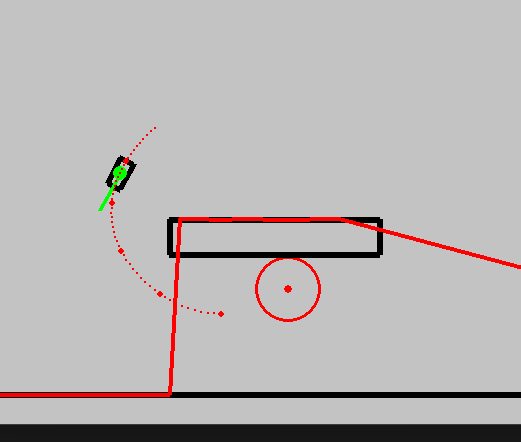

# masters_thesis_2027

Master's thesis project. The code is based on Henrik Fjellheim's master's thesis
"Short-Term Trajectory Planning for a Non-Holonomic Robot Car: Utilizing Reinforcement Learning
in conjunction with a Predefined Vehicle Model" (NTNU, 2023).
Original repo: https://github.com/henrfj/master_thesis_2023



## Setup

```
python3 -m venv venv
source venv/bin/activate
pip install -r requirements.txt
```

Runs on CPU by default. To use an NVIDIA GPU, set `disable_cuda=False` in `DDPG/ddpg_torch.py`.
Run all commands from the repo root.

## Running

Drive the car with the arrow keys (Henrik's keyboard mode):

```
python -c "from DDPG.visualize_ddpg import visualize_v23; visualize_v23(folder='DDPG/checkpoints/v23', user_controlled=True)"
```

Up/down is throttle and reverse, left/right is steering. Close the window to quit.
This needs torch, since the trained agent is loaded.

Simulation with only rule-based drivers:

```
python visualization.py                # Henrik's "boats" demo, using the car model
python visualization.py vehicle=car    # same as above
python visualization.py vehicle=boat   # same basin with the boat model (Boat.py)
python visualization.py cars           # cars in a city block map
```

With `vehicle=boat` the drivers are retuned because a boat stops and turns more slowly than the car:
top speed 4 m/s, the dynamic circogram looks 5 s ahead, the driver stops at a lower risk, and the
boats brake with reverse thrust (`boat_speed_command`). The settings are arguments of
`driving_with_boat_model` in `visualization.py`.

Trained agents:

```
python -m DDPG.visualize_ddpg pdrl
python -m DDPG.visualize_ddpg pdrl_dynamic
python -m DDPG.visualize_ddpg ddpg
python -m DDPG.visualize_ddpg ddpg_dynamic
```

Training:

```
python -m DDPG.main_torch pdrl [episodes]
python -m DDPG.main_torch ddpg [episodes]
python -m DDPG.main_torch ddpg_dynamic [episodes]
```

Weights are saved to `DDPG/checkpoints/my_*` and plots to `DDPG/plots/`.

## Boat

`Boat.py` is a boat model based on the course notes "Time-Discrete Motion Model of a Simple Boat
with Rotatable Thruster", using the refined version with separate surge and sway drag.
It can replace the car in `ClosedField_v23_dyna`.

Drive the boat with the arrow keys:

```
python -m DDPG.visualize_ddpg keyboard_boat
```

Up/down is forward and reverse thrust, with no key pressed the boat drifts. Left/right turns
the thruster. The other vessels are boats as well.

Mass, thrust, drag and size are the default values in `Boat.__init__`.

Notes on the model:

- The thruster is at the stern, so the torque is -d F sin(delta). The code uses the steering
  angle alpha = -delta, which gives d F sin(alpha) as in the notes.
- The velocity is stored in the body frame and rotated each step as the boat turns. With
  `c_sway = c_surge` and no actuator delay the model gives the same result as Task 3 in the notes.
- Thrust and thruster angle follow the commands with a small delay (`tau_thrust`,
  `tau_steering`). This is not part of the notes.

## Weather

`Weather.py` gives the water current and the wind for the boat simulation. The settings are at
the top of the file and are used by `keyboard_boat`:

- `CURRENT`, `WIND`: (x, y) in m/s, where x is right and y is down on the screen
- `CURRENT_CHANGE`, `WIND_CHANGE`: chance per second that the direction changes
- `WIND_GUST`: (min, max) wind speed in m/s, or `None` for a constant speed
- `GUST_TIME`: how long a gust lasts, in seconds
- `MAX_DIRECTION_CHANGE`: largest change in direction, in degrees
- `SEED`: set a number to get the same random sequence each run

Current and wind are shown in the top left corner. All boats get the same weather.

How it acts on the boat (in `Boat.py`):

- The current is added in the position update. With no thrust the boat drifts with the current.
- The wind is a constant force at the centre of mass. It does not depend on the boat's speed
  and does not turn the boat.
- With gusts, the wind speed follows a random walk inside the given range, updated every 0.5 s.
  Direction changes are instant.

## Checkpoints

`v22`, `v22_naples_nn` and `v23` are Henrik's trained weights for the car. `v40_fw` is also from
his repo, but it is not used by any of the commands above and contains the same weights as `v22`.

## Files

```
Object.py           obstacles (polygons)
Vehicle.py          car model and circograms (simulated lidar)
Boat.py             boat model
Weather.py          current and wind settings
Agent.py            rule-based driver for the other vehicles
limo.py             pairs a Vehicle with an Agent
visualization.py    pygame drawing, maps and demos
DDPG/
  ddpg_torch.py     DDPG networks, Agent (DDPG) and MPC_Agent (PDRL)
  environments.py   gym environments
  main_torch.py     training
  visualize_ddpg.py running trained agents and keyboard mode
  utils.py          learning curve plot
  checkpoints/      trained weights
```

Environments in `DDPG/environments.py`:

- `ClosedField_v22`: DDPG, static maps (`four_walls`, `naples_street`)
- `ClosedField_v23_dyna`: DDPG, open area with 6 rule-based vehicles, car or boat
- `MPC_environment_v40`: PDRL, static maps
- `MPC_environment_v41`: PDRL with rule-based vehicles

## Changes from Henrik's repo

- Removed `main.py`, `Testing.py`, the notebooks, `dev_ideas.md`, the A* planner, environments
  v00 to v21 and their training and visualization functions, `ST_approximator.py`,
  `data_collection.py`, the training data, unused methods, and most checkpoints and figures.
- `Vehicle.py`: fixed the state indexing so it runs with numpy 2.
- Checkpoint folders are created when saving.
- `main_torch.py`, `visualize_ddpg.py` and `visualization.py` take the mode as a command line
  argument instead of commenting function calls in and out.
